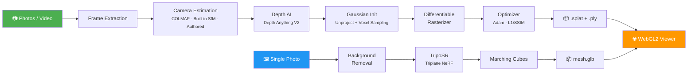

<div align="center">

# 🌀 Kinesplat

### *Turn photos into explorable 3D worlds — right from your browser.*

[](https://python.org)
[](https://pytorch.org)
[](#)
[](#credits)
[](#gpu--vram)

<br>

**Drop photos or video → get an interactive 3D scene.  
Drop a single photo → get a textured 3D mesh.  
No cloud. No login. Everything stays on your machine.**

<br>

```
📸 photos / video  →  frames  →  cameras  →  depth AI  →  3D Gaussians  →  .splat
                                                                              ↓
                                                          WebGL2 viewer in browser

🖼️ single photo    →  cut-out  →  TripoSR NeRF  →  marching cubes  →  mesh.glb
                                                                              ↓
                                                          WebGL2 viewer in browser
```

</div>

---

## ⚡ Quick Start

```powershell
# Clone
git clone https://github.com/harishyuvaraj641-pixel/Kinesplat.git
cd Kinesplat

# 1️⃣  One-time setup — auto-detects your hardware
.\setup.ps1              # CUDA when NVIDIA GPU found, else CPU
.\setup.ps1 -Gpu         # force CUDA build (~2.8 GB download)
.\setup.ps1 -Cpu         # force CPU-only (smallest install)

# 2️⃣  Launch
.\run.ps1
```

> **Open http://127.0.0.1:8000** — the bundled Toy Courtyard demo loads instantly.  
> The header shows your detected device (e.g. `GPU · 8.0 GB` or `CPU`).

<details>
<summary><strong>🔧 Manual setup (any OS)</strong></summary>

```bash
python -m venv .venv

# CPU-only PyTorch:
.venv/Scripts/python -m pip install "torch>=2.2" --index-url https://download.pytorch.org/whl/cpu

# …or CUDA 12.8 (NVIDIA GPU):
.venv/Scripts/python -m pip install "torch==2.11.0+cu128" --index-url https://download.pytorch.org/whl/cu128

.venv/Scripts/python -m pip install -r requirements.txt
.venv/Scripts/python -m splatlab.server --open
```

</details>

---

## 🎯 Features

| | Feature | Details |
|---|---|---|
| 📷 | **Multi-view → Splats** | Upload 12–60 photos or a short video. Get a navigable 3D Gaussian Splatting scene. |
| 🖼️ | **Single Photo → Mesh** | One image auto-routes to TripoSR: you get a textured `.glb` mesh, not an error. |
| 🌐 | **Browser Viewer** | Custom WebGL2 renderer with orbit, pan, zoom, auto-rotate, camera jump, and fullscreen. |
| ⚡ | **GPU & CPU** | Same code runs on both. CUDA gives 5–7× speedup; 4 GB VRAM is enough. |
| 📚 | **Job Library** | Every reconstruction is saved. Revisit, compare, or delete from the Library tab. |
| 🔒 | **100% Local** | No cloud, no account, no telemetry. Server binds to `127.0.0.1`. |
| 🎛️ | **Quality Presets** | Draft (15s GPU), Balanced (2min), Quality (6min) — pick your trade-off. |
| 📊 | **Live Progress** | Watch frames → cameras → depth → optimization → export in real time with preview. |

---

## 🏗️ Architecture



### Pipeline Stages

| Stage | Module | What Happens |
|-------|--------|-------------|
| **Frames** | `splatlab/capture.py` | Resizes images, samples video keyframes, reads EXIF focal length |
| **Cameras** | `splatlab/poses.py` `sfm.py` `colmap.py` | COLMAP → built-in SfM → authored calibration (cascade fallback) |
| **Depth** | `splatlab/depth.py` | Depth Anything V2 Small (pretrained ONNX) per frame |
| **Init** | `splatlab/gaussians.py` | Unprojects depth → 3D Gaussians → uniform voxel thinning |
| **Optimize** | `splatlab/trainer.py` `rasterizer.py` | Differentiable rasteriser (CUDA/CPU), Adam + L1/SSIM, warmup, best-checkpoint |
| **Export** | `splatlab/exporter.py` | `model.splat` (32 B/splat), 3DGS `.ply`, `scene.json`, metrics, previews |
| **View** | `web/viewer.js` | WebGL2 instanced splats: covariance projection, 16-bit depth sort, premultiplied α |

### Single Photo → Mesh (TripoSR)

| Stage | What Happens |
|-------|-------------|
| **Cut-out** | `rembg` removes background; existing alpha preserved |
| **Condition** | Crop → pad to square (85% foreground) → 512 px |
| **Predict** | ViT-B/16 encoder → 16-layer transformer → 3×32×32×1024 triplane NeRF |
| **Extract** | 8,192-point chunks → 256³ marching-cubes → per-vertex colour sampling |
| **Export** | `mesh.glb` / `mesh.ply` / preview contact sheet |

---

## 🎮 GPU & VRAM

Kinesplat's VRAM guard auto-clamps to what fits your card:

| VRAM | Train Resolution | Max Splats |
|------|-----------------|------------|
| < 4.5 GB | 256 px | 120,000 |
| 4.5–6.5 GB | 320 px | 200,000 |
| 6.5–9 GB | 384 px | 300,000 |
| ≥ 9 GB | 512 px | 400,000 |

> **Benchmarks** (RTX 5050 Laptop GPU):  
> - Peak VRAM: **0.74 GB** for 53K splats at 256 px  
> - Speed: **~0.2 s/iter** (GPU) vs **~1.6 s/iter** (CPU) — **5–7× faster**  
> - Install size: ~1.2 GB (CPU) · ~4.9 GB (with CUDA)

---

## 🎚️ Quality Presets

| Preset | Resolution | Frames | Max Splats | Steps | ⏱️ CPU | ⏱️ GPU |
|--------|-----------|--------|-----------|-------|--------|--------|
| **Draft** | 128 px | 16 | 20K | 260 | ~40s | ~15s |
| **Balanced** | 192 px | 28 | 90K | 700 | ~12min | ~2min |
| **Quality** | 256 px | 40 | 180K | 1,200 | ~35min | ~6min |

---

## 💻 CLI Reference

```powershell
# Rebuild the bundled demo
python -m splatlab.cli demo --preset draft --out outputs/demo

# Reconstruct from photos
python -m splatlab.cli images .\photos --name "Back garden" --preset balanced

# Single photo → mesh (auto-detected)
python -m splatlab.cli images .\photo.jpg --name "Vase"

# Mesh backend directly with custom resolution
python -m splatlab.cli mesh .\photo.jpg --resolution 192

# Force built-in SfM
python -m splatlab.cli images .\clip.mp4 --poses sfm

# Pick compute device
python -m splatlab.cli images .\photos --device cuda
python -m splatlab.cli demo --device cpu

# Model management
python -m splatlab.cli model --check           # check status
python -m splatlab.cli model                   # download depth model
python -m splatlab.cli model --triposr         # download TripoSR (1.7 GB)

# Start server without browser
python -m splatlab.server --port 8000 --device cuda
```

---

## 📁 Project Structure

```
Kinesplat/
├── 🧠 splatlab/               # Core Python package
│   ├── server.py              #   Web server & API
│   ├── pipeline.py            #   Orchestrates the full reconstruction
│   ├── capture.py             #   Frame extraction & EXIF parsing
│   ├── poses.py / sfm.py      #   Camera estimation (SfM)
│   ├── colmap.py              #   COLMAP integration
│   ├── depth.py               #   Depth Anything V2 inference
│   ├── gaussians.py           #   3D Gaussian initialization
│   ├── trainer.py             #   Differentiable optimization loop
│   ├── rasterizer.py          #   Custom CUDA/CPU rasteriser
│   ├── exporter.py            #   .splat / .ply / .glb export
│   ├── mesh.py                #   Single-photo TripoSR mesh backend
│   └── cli.py                 #   Command-line interface
├── 🔮 tsr/                    # Vendored TripoSR network (MIT)
│   ├── system.py              #   Model loading & inference
│   └── models/                #   ViT tokenizer, transformer, NeRF
├── 🌐 web/                    # Browser studio
│   ├── index.html             #   App shell
│   ├── app.js                 #   Upload, library, progress UI
│   ├── viewer.js              #   WebGL2 splat + mesh renderer
│   ├── style.css              #   Studio styling
│   └── vendor/                #   Three.js + OrbitControls
├── 🎨 assets/demo/            # Bundled demo scene (48 views + result)
├── 📦 models/                 # Pretrained weights (auto-downloaded)
├── setup.ps1 / run.ps1        # Windows quick-start scripts
└── requirements.txt           # Python dependencies
```

---

## 📤 Output Formats

### Multi-view (Gaussian Splatting)
```
jobs/<id>/work/output/
├── model.splat      # Compact splat format (32 bytes/splat)
├── model.ply        # 3DGS-compatible binary PLY
├── scene.json       # Bounds, cameras, metrics
├── cameras.json     # Calibrated camera poses
├── metrics.json     # PSNR, splat count, timings
├── preview.png      # Rendered splat view
└── poster.jpg       # Source thumbnail
```

### Single Photo (Mesh)
```
jobs/<id>/work/output/
├── mesh.glb         # Binary glTF (positions, normals, vertex colors)
├── mesh.ply         # Same mesh for Blender / MeshLab
├── condition.png    # 512 px cut-out fed to network
├── preview.png      # 2×2 NeRF contact sheet
└── poster.jpg       # Original photo
```

<details>
<summary><strong>📐 .splat binary layout (32 bytes per Gaussian)</strong></summary>

| Bytes | Content |
|-------|---------|
| 0–11 | Position `(x, y, z)` float32 |
| 12–23 | Scale `(sx, sy, sz)` float32 |
| 24–27 | RGBA uint8 (opacity in A) |
| 28–31 | Rotation quaternion uint8 `(q × 128 + 128)`, w-first |

</details>

---

## 📋 Requirements

| Component | Requirement |
|-----------|------------|
| **Python** | 3.10+ (tested with 3.13) |
| **RAM** | 8 GB recommended |
| **CPU** | x86-64 with AVX |
| **GPU** | *Optional* — any NVIDIA GPU with CUDA 12.8, 4 GB+ VRAM |
| **Browser** | WebGL2 (Chrome, Edge, Firefox, Safari 15+) |
| **COLMAP** | *Optional* — falls back to built-in SfM |
| **Apple Silicon** | `--device mps` (best effort) |

---

## 📸 Tips for Great Captures

> 🎯 **Move slowly** · Keep **60–80% overlap** between views  
> 🔒 **Lock exposure & focus** · Avoid auto-adjustments mid-capture  
> 🚫 **Avoid** blank walls, pure sky, and reflective surfaces  
> 🔄 **Circle the subject** from multiple angles — don't just pan in place  
> 💡 **Even lighting** produces the cleanest results

---

## 🔧 Troubleshooting

<details>
<summary><strong>Click to expand common issues & fixes</strong></summary>

| Symptom | Fix |
|---------|-----|
| `Python was not found` | Install Python 3.10+ and enable "Add Python to PATH" |
| Viewer stays black | Check browser console — WebGL2 required |
| "Not enough registered frames" | Capture more overlapping views, or supply calibrated cameras |
| Depth model download fails | Download manually from the URL in `splatlab/config.py` → save as `models/depth_anything_v2_small.onnx` |
| Build is slow | Use Draft preset; close CPU-heavy apps; try `--device cuda` for 5–7× speedup |
| `CUDA was requested but no CUDA support` | Run `.\setup.ps1 -Gpu` to install CUDA PyTorch |
| GPU out of memory | Lower preset to Draft, or use `--device cpu` |
| Port 8000 busy | `.\run.ps1 -Port 8010` or `--port 8010` |
| Single photo fails | Run `python -m splatlab.cli model --triposr` to download mesh weights |
| Mesh is spiky/empty | Try `--threshold 15`; use a well-lit subject against a plain background |

</details>

---

## 🙏 Credits

- **[TripoSR](https://github.com/VAST-AI-Research/TripoSR)** — Tripo AI & Stability AI (MIT) — feed-forward 3D mesh network
- **[Depth Anything V2](https://github.com/DepthAnything/Depth-Anything-V2)** — Lihe Yang et al. (Apache-2.0) — monocular depth estimation
- **[Three.js](https://threejs.org)** — MIT — vendored in `web/vendor`
- Kinesplat's rasteriser, SfM, trainer, mesh exporter, and viewer are **original code**

---

<div align="center">

**Built with 💜 and Gaussian Splats**

*If this project helped you, consider giving it a ⭐*

</div>
